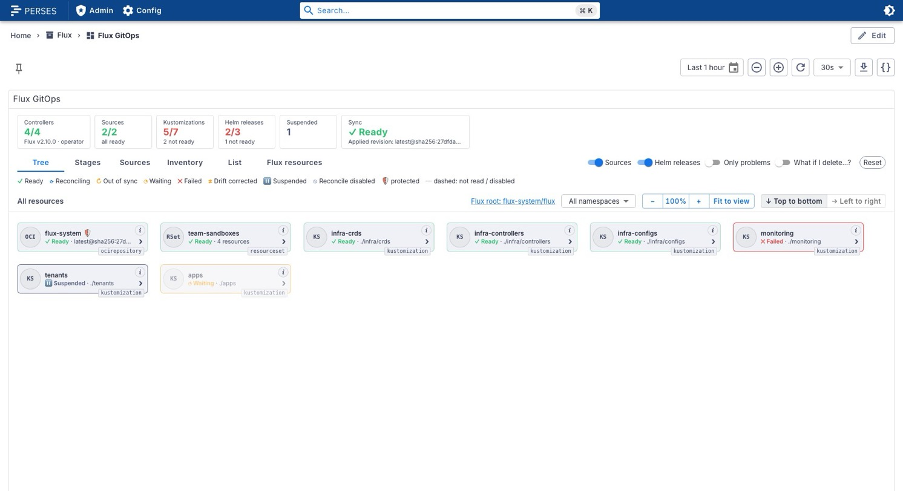
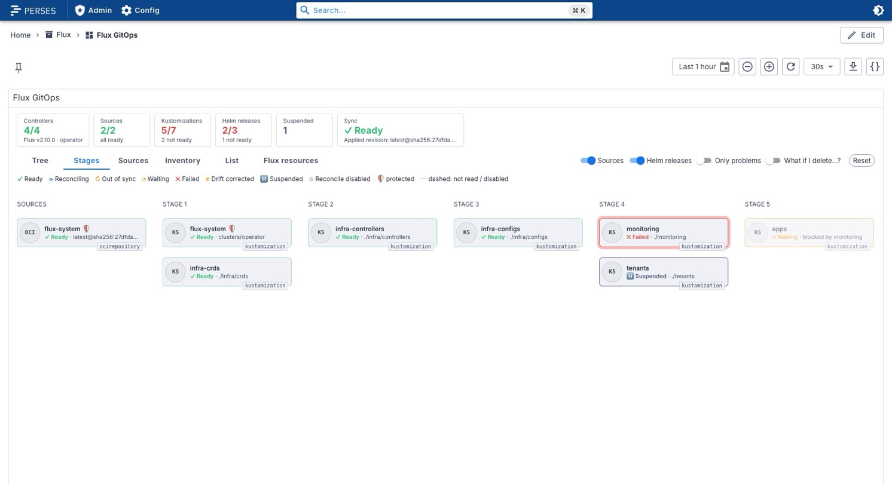
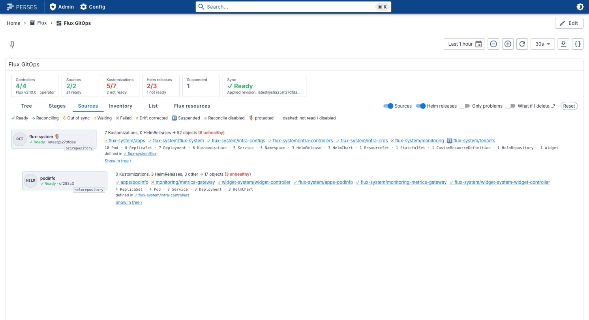
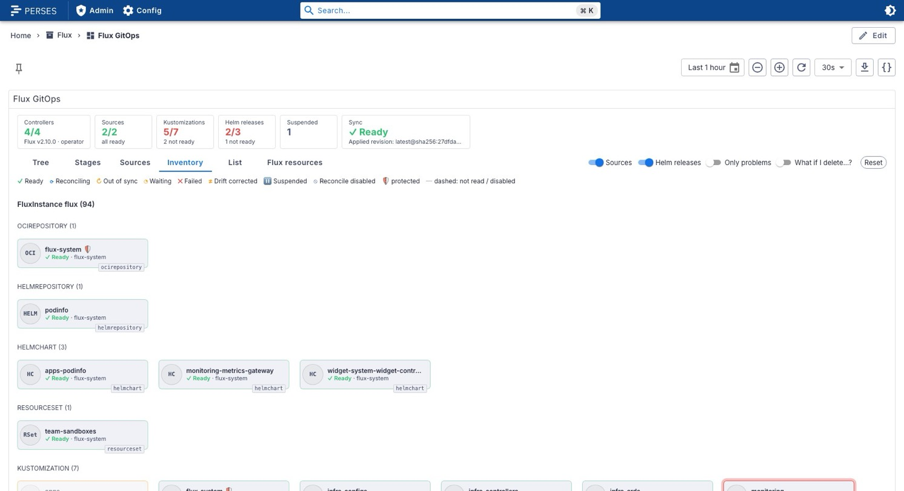
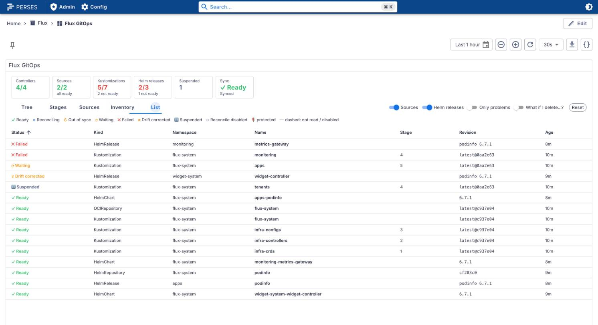
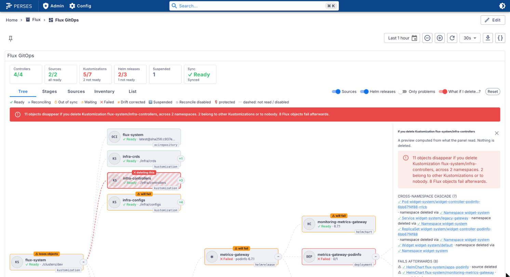

# perses-plugin-flux

A [Perses](https://github.com/perses/perses) panel for [Flux](https://fluxcd.io) GitOps, with or without the
[Flux Operator](https://fluxoperator.dev). One panel, `FluxGitOpsChart`, shows every Kustomization, HelmRelease and
source, what each one applied down to the pods, why something is not ready, how long it has been broken, and what
would really disappear if you deleted it.

It is read-only. Reconcile, suspend and resume stay in the `flux` CLI or the Flux Operator web UI; the panel links
there.

- **Live state** from the Kubernetes API through the
  [Kubernetes datasource](https://github.com/astrona-io/perses-plugin-kubernetes) (read-only, through the Perses
  proxy).
- **History** from Prometheus: Ready bands per Kustomization over the dashboard's time range, a ◆ where the
  revision changed, and the mean reconcile duration.
- **Delete impact**: switch on "What if I delete...?" and click a Kustomization, HelmRelease, source, ResourceSet
  or the root. Nothing is deleted; the panel works out what Flux and Kubernetes would remove, including namespace
  and CRD cascades into other teams' objects, lost volumes, and what fails afterwards.

<picture>
  <source media="(prefers-color-scheme: dark)" srcset="docs/images/tree-dark.jpg">
  
</picture>

## Supported versions

| Component | Version | Notes |
| --- | --- | --- |
| Perses | v0.55.1 | `@perses-dev/*` 0.55.1; tested with the `persesdev/perses:v0.55.1` image |
| Kubernetes datasource | [astrona-io/perses-plugin-kubernetes](https://github.com/astrona-io/perses-plugin-kubernetes) v0.1.0 | required |
| Flux | v2.7 to v2.10 (tested with v2.10.0) | `source.toolkit.fluxcd.io/v1`, `kustomize.toolkit.fluxcd.io/v1`, `helm.toolkit.fluxcd.io/v2`. The HelmRelease inventory needs Flux 2.8+; before that the Helm labels find what a release installed. |
| Flux Operator | v0.62.1 (tested) | `fluxcd.controlplane.io/v1`, optional |
| Kubernetes | tested on v1.37.0 (kind) | |

## What it shows

Six views, a header and a drawer:

- **KPI tiles**: controllers ready, sources, Kustomizations, Helm releases, suspended, and the sync status (from
  the FluxReport when the Flux Operator is installed).
- **Tree**: root Kustomization (or FluxInstance) to Kustomizations to HelmReleases and objects to everything Helm
  installed, down to ReplicaSets and Pods. Problem branches open, healthy ones collapsed; more objects of one kind
  under one parent than `groupThreshold` are grouped ("8 ServiceMonitors"). Cards keep their size and the tree
  scrolls.
- **Stages**: Kustomizations by their `dependsOn` depth, sources on the left. A failed stage marks what comes after
  it as waiting.
- **Sources**: every source with what it feeds and delivers, and source chains ("defined in infra-controllers").
- **Inventory**: everything the selected Kustomization or HelmRelease manages, grouped by kind.
- **List**: every Flux object in a sortable table, problems first.
- **Flux resources**: the Flux installation, its controllers and how many objects of each Flux kind are in which
  state. See [Flux resources](#flux-resources).
- **Drawer**: conditions with reason and message, revisions with commit links, Helm history, recent events, what
  the object blocks, and links to the Flux Operator web UI.

States: Ready ✓, Reconciling, Out of sync ↻, Waiting ◔, Failed ✕, Drift corrected ≠, Suspended ⏸, Reconcile
disabled (dashed), protected 🛡. Every state has a label and an icon, never colour alone, and animations stop
under `prefers-reduced-motion`.

| Stages | Sources |
| --- | --- |
| <picture><source media="(prefers-color-scheme: dark)" srcset="docs/images/stages-dark.jpg"></picture> | <picture><source media="(prefers-color-scheme: dark)" srcset="docs/images/sources-dark.jpg"></picture> |
| **Inventory** | **List** |
| <picture><source media="(prefers-color-scheme: dark)" srcset="docs/images/inventory-dark.jpg"></picture> | <picture><source media="(prefers-color-scheme: dark)" srcset="docs/images/list-dark.jpg"></picture> |

### Delete impact

<picture>
  <source media="(prefers-color-scheme: dark)" srcset="docs/images/delete-impact-dark.jpg">
  
</picture>

The rules, with the Flux docs and code they come from, are in [docs/DECISIONS.md](docs/DECISIONS.md#delete-impact):

- A Kustomization deletes its inventory by `spec.deletionPolicy` (`MirrorPrune` only with `prune: true`),
  except objects annotated `kustomize.toolkit.fluxcd.io/prune: disabled`. HelmReleases in it are uninstalled.
- A HelmRelease uninstall removes what it installed, except CRDs and `helm.sh/resource-policy: keep`.
- A suspended Kustomization or HelmRelease deletes nothing.
- A Namespace takes everything in it, a CRD every object of its kind, an owner its dependents; repeated until
  nothing changes. A protected Namespace stops the cascade.
- A source deletes nothing, but everything that reads from it fails.
- A FluxInstance removes Flux but leaves the workloads; a ResourceSet removes what it generated.

## Flux and the Flux Operator

| | Plain Flux | With the Flux Operator |
| --- | --- | --- |
| Root of the tree | `flux-system/flux-system` Kustomization (option `rootKustomization`) | the FluxInstance |
| Controllers tile | the controller Deployments in `flux-system` | the FluxReport's components |
| Sync tile | the root Kustomization | the FluxReport's `sync` |
| Extra nodes | none | FluxInstance, ResourceSets (their objects as children), ResourceSetInputProviders |
| History metric | `gotk_resource_info` from kube-state-metrics, with the [KSM config](#kube-state-metrics-config) | `flux_resource_info`, exported by the operator; no KSM config needed |
| Links | commit links (`gitCommitUrl`) | also the Flux Operator web UI (`fluxWebUIUrl`) |

The panel detects which is installed: when the `fluxcd.controlplane.io` lists answer, it uses them; when they
return 404 it carries on with plain Flux.

### Flux resources

The `flux` view shows Flux itself, and always says where its numbers come from:

| | Plain Flux | With the Flux Operator |
| --- | --- | --- |
| Installation | none | FluxInstance: Ready, version requested and running, distribution, registry, last applied revision, components, sync source; operator and cluster versions |
| Controllers | the controller Deployments: ready replicas, image and tag | the FluxReport's `components`: ready, status, image |
| Objects by kind | counted by the panel from what it read: total, ready, reconciling, waiting, failed, suspended | the FluxReport's `reconcilers`: running, failing, suspended, artifact storage |

With the Prometheus datasource set, each kind also gets reconciles per minute and the mean reconcile duration over
the dashboard range (`gotk_reconcile_duration_seconds`). A list the panel could not read shows its error, never zero.
The panel's own counts cover only the namespaces in the `namespaces` option. The FluxReport is refreshed by the
operator and can lag a few minutes. Field sources are in [docs/DECISIONS.md](docs/DECISIONS.md#flux-resources-view).

## Security model

- The panel only issues `GET` list requests through the Kubernetes datasource, which goes through the Perses proxy.
  The proxy refuses any path that does not match the datasource's `allowedEndpoints`.
- It never reads Secrets, ConfigMaps or ServiceAccounts: the datasource cannot do metadata-only reads, so reading
  them would pull Secret data through the proxy. Inventory entries of those kinds are drawn from the inventory,
  dashed, "not read".
- No writes, no watch, no subresources (`status`, `log`, `exec`, `proxy`).

## Setup

### RBAC

Grant this to the service account Perses talks to the API server as ([`deploy/rbac.yaml`](deploy/rbac.yaml)
also has the binding):

```yaml
apiVersion: rbac.authorization.k8s.io/v1
kind: ClusterRole
metadata:
  name: perses-flux-gitops-panel
rules:
  # Flux
  - apiGroups: [source.toolkit.fluxcd.io]
    resources: [gitrepositories, ocirepositories, helmrepositories, helmcharts, buckets]
    verbs: [get, list]
  - apiGroups: [kustomize.toolkit.fluxcd.io]
    resources: [kustomizations]
    verbs: [get, list]
  - apiGroups: [helm.toolkit.fluxcd.io]
    resources: [helmreleases]
    verbs: [get, list]
  # Flux Operator (harmless when it is not installed)
  - apiGroups: [fluxcd.controlplane.io]
    resources: [fluxinstances, fluxreports, resourcesets, resourcesetinputproviders]
    verbs: [get, list]
  # Objects in inventories and the workloads under them, plus events for the drawer
  - apiGroups: ['']
    resources: [namespaces, pods, services, persistentvolumeclaims, events]
    verbs: [get, list]
  - apiGroups: [apps]
    resources: [deployments, statefulsets, daemonsets, replicasets]
    verbs: [get, list]
```

A missing permission shows a warning naming the refused lists, not an empty panel.

### Kubernetes datasource allowedEndpoints

Every path the panel requests, as anchored `GET` patterns (the Perses proxy matches the method exactly and the path
with an unanchored Go regexp, so the anchors matter).
[`deploy/kubernetes-datasource.json`](deploy/kubernetes-datasource.json) is a complete in-cluster
`GlobalDatasource`; CI checks it with Go's `regexp` against every path the panel builds and a list of paths it must
refuse.

```json
"allowedEndpoints": [
  { "method": "GET", "endpointPattern": "^/api/v1/namespaces$" },
  { "method": "GET", "endpointPattern": "^/api/v1/(namespaces/[a-z0-9]([-a-z0-9]*[a-z0-9])?/)?(pods|events|services|persistentvolumeclaims)$" },
  { "method": "GET", "endpointPattern": "^/apis/apps/v1/(namespaces/[a-z0-9]([-a-z0-9]*[a-z0-9])?/)?(deployments|statefulsets|daemonsets|replicasets)$" },
  { "method": "GET", "endpointPattern": "^/apis/source\\.toolkit\\.fluxcd\\.io/v1/(namespaces/[a-z0-9]([-a-z0-9]*[a-z0-9])?/)?(gitrepositories|ocirepositories|helmrepositories|helmcharts|buckets)$" },
  { "method": "GET", "endpointPattern": "^/apis/kustomize\\.toolkit\\.fluxcd\\.io/v1/(namespaces/[a-z0-9]([-a-z0-9]*[a-z0-9])?/)?kustomizations$" },
  { "method": "GET", "endpointPattern": "^/apis/helm\\.toolkit\\.fluxcd\\.io/v2/(namespaces/[a-z0-9]([-a-z0-9]*[a-z0-9])?/)?helmreleases$" },
  { "method": "GET", "endpointPattern": "^/apis/fluxcd\\.controlplane\\.io/v1/(namespaces/[a-z0-9]([-a-z0-9]*[a-z0-9])?/)?(fluxinstances|fluxreports|resourcesets|resourcesetinputproviders)$" }
]
```

The namespaced forms are used when the panel's `namespaces` option is set.

### Perses proxy: allow the API server's IP

Perses must be allowed to reach the API server in `datasource.proxy.allowed_networks`. In Perses v0.55.1 the
service CIDR alone was not enough: `10.96.0.0/16` still refused `10.96.0.1`, the `kubernetes` Service. Add the
Service IP as a /32:

```bash
kubectl get svc kubernetes -n default -o jsonpath='{.spec.clusterIP}'
```

```yaml
datasource:
  proxy:
    allowed_networks:
      - 10.96.0.1/32 # the API server's Service IP
      - 10.96.0.0/16
```

The panel recognises the proxy's refusal and says this instead of listing every failed request.

### kube-state-metrics config

Only for plain Flux without the Flux Operator.
[`deploy/kube-state-metrics-config.yaml`](deploy/kube-state-metrics-config.yaml) is the config from
[fluxcd/flux2-monitoring-example](https://github.com/fluxcd/flux2-monitoring-example), cut to the seven kinds the
panel reads and extended with `reason`, `path` and `source_name`; see [docs/metrics.md](docs/metrics.md). With
kube-prometheus-stack, put its `spec:` under `kube-state-metrics.customResourceState.config` and add the
`list`/`watch` rule from the file's header to `kube-state-metrics.rbac.extraRules`. Prometheus should also scrape the
Flux controllers for `gotk_reconcile_duration_seconds`.

## The panel: FluxGitOpsChart

Every option is optional.

| Option | Default | |
| --- | --- | --- |
| `kubernetesDatasource` | the project's default `KubernetesDatasource` | live state |
| `prometheusDatasource` | the project's default `PrometheusDatasource` | history |
| `cluster` | none | value of the `cluster` label in Prometheus queries |
| `namespaces` | all | only these namespaces (cluster-scoped objects always show) |
| `rootKustomization` | `auto` (`flux-system/flux-system`, or the FluxInstance) | `name` or `namespace/name` |
| `defaultView` | `tree` | `tree`, `stages`, `sources`, `inventory`, `list`, `flux` |
| `showSources` | `true` | |
| `showHelmReleases` | `true` | |
| `onlyProblems` | `false` | keep only problems and the path to them |
| `showPods` | `true` | |
| `groupThreshold` | `2` | more objects of one kind under one parent are grouped (1 to 100) |
| `historyRange` | the dashboard's time range | a duration, e.g. `6h`, `1d` |
| `showHistory` | `true` | |
| `fluxWebUIUrl` | none | e.g. `https://flux.example.com/resource/${kind}/${namespace}/${name}` |
| `gitCommitUrl` | none | e.g. `https://${repo}/commit/${revision}` |
| `enableDeleteImpact` | `true` | shows the "What if I delete...?" toggle |

```json
{
  "kind": "FluxGitOpsChart",
  "spec": {
    "kubernetesDatasource": { "kind": "KubernetesDatasource", "name": "kubernetes" },
    "fluxWebUIUrl": "https://flux.example.com/resource/${kind}/${namespace}/${name}",
    "gitCommitUrl": "https://${repo}/commit/${revision}"
  }
}
```

## Try it locally

Needs podman (or Docker), kind, kubectl, flux, helm, curl, Node.js 24 and `percli`. Two profiles, each its own kind
cluster, which can run at the same time:

```bash
dev/up.sh flux        # plain Flux v2.10.0:     http://127.0.0.1:18090/projects/flux/dashboards/gitops
dev/up.sh operator    # Flux Operator v0.62.1:  http://127.0.0.1:18191/projects/flux/dashboards/gitops
dev/push-commit.sh flux broken   # push a new fleet commit (healthy | broken | bump) and watch the states change
dev/reload.sh flux    # rebuild the plugin and restart Perses
dev/down.sh flux      # delete the cluster
```

Each profile pushes a staged fleet as OCI artifacts to a local registry: infra-crds, infra-controllers,
infra-configs (Namespaces for later stages, one protected with `prune: disabled`, one object with
`reconcile: disabled`), monitoring (a Helm upgrade that fails, and a StatefulSet with a PVC), apps (waiting on
monitoring) and a suspended tenants Kustomization. A HelmRelease with drift detection is scaled by hand so
helm-controller corrects it. Prometheus with kube-state-metrics and Perses with this panel and the Kubernetes
datasource run in the cluster. The operator profile adds a FluxInstance, a FluxReport and a ResourceSet, and the
Flux Operator web UI on http://127.0.0.1:18193. The kubeconfig goes to `dev/.state/<profile>/kubeconfig`, never
`~/.kube/config`.

## Build

```bash
npm ci
npm run format:check && npm run lint && npm run type-check && npm test
(cd test/allowlist && go test ./...)
cue mod tidy --check && percli plugin test-schemas
npm run build && percli plugin build   # writes FluxGitOps-<version>.tar.gz
```

## Install into Perses

Perses extracts every `*.tar.gz` in `plugin.archive_paths` into `plugin.path` at startup. Setting `archive_paths`
replaces the default, so keep the directory of bundled plugins in the list. Install the
[Kubernetes datasource](https://github.com/astrona-io/perses-plugin-kubernetes) the same way, add the
[setup](#setup) above, and restart Perses.

### Option A: release archive

```bash
curl -fLO https://github.com/astrona-io/perses-plugin-flux/releases/download/v0.1.0/FluxGitOps-0.1.0.tar.gz
curl -fLO https://github.com/astrona-io/perses-plugin-flux/releases/download/v0.1.0/FluxGitOps-0.1.0.tar.gz.sha256
sha256sum -c FluxGitOps-0.1.0.tar.gz.sha256
```

```yaml
plugin:
  archive_paths:
    - /etc/perses/plugins-archive # plugins bundled with Perses
    - /etc/perses/plugins-archive-flux # put FluxGitOps-0.1.0.tar.gz here
```

### Option B: Kubernetes image volume

Every release publishes the archive as a plugin-only OCI image (`FROM scratch`, the archive at the image root),
`ghcr.io/astrona-io/perses-plugin-flux:v<version>`, for linux/amd64 and linux/arm64. Mount it as an
[image volume](https://kubernetes.io/docs/concepts/storage/volumes/#image) (the `ImageVolume` feature) and add the
mount path to `archive_paths` as in option A:

```yaml
volumes:
  - name: flux-plugin
    image:
      reference: ghcr.io/astrona-io/perses-plugin-flux:v0.1.0
      pullPolicy: IfNotPresent
containers:
  - name: perses
    volumeMounts:
      - name: flux-plugin
        mountPath: /etc/perses/plugins-archive-flux
        readOnly: true
```

### Option C: custom Perses image

```dockerfile
FROM persesdev/perses:v0.55.1
COPY FluxGitOps-0.1.0.tar.gz /etc/perses/plugins-archive/
```

## Documentation

- [docs/DECISIONS.md](docs/DECISIONS.md): what was decided where the spec was silent, with the Flux docs and code
  each rule comes from, and the Kubernetes datasource's limits.
- [docs/metrics.md](docs/metrics.md): the Prometheus metrics and labels.
- [docs/PLAN.md](docs/PLAN.md): data model and component tree.
- [docs/PROMPT.md](docs/PROMPT.md): the original spec.

## Licences and credits

Apache-2.0, see [LICENSE](LICENSE) and [NOTICE](NOTICE). Built on Perses (Apache-2.0). Flux and the Flux Operator
are projects of their authors; this plugin only reads their APIs and metrics.
